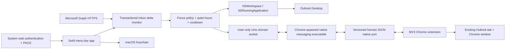

# Legacy Outlook implementation

These notes describe the previous Microsoft Graph and Chrome version. The current macOS app monitors Apple Mail.

# MailFocus

**Intelligent email detection and window focus for macOS + Google Chrome.**

MailFocus is a native menu-bar utility that monitors one Microsoft Inbox through Microsoft Graph and activates either Outlook Desktop or an existing Outlook Web tab. It runs without an open settings window, a custom server, or a subscription to a third-party service.

[Source on GitHub](https://github.com/K3V88/outlookfocus-macos) · [MIT license](LICENSE) · [Protocol](docs/PROTOCOL.md) · [Testing](docs/TESTING.md)

**Setup is required:** register your own Microsoft Entra public-client application, enter its client ID in the Mac app, sign in, and optionally install the Chrome component and native host. No Microsoft registration, credentials, or extension ID is invented or included. Real account sign-in and incoming-mail end-to-end behavior have not been tested against a user's mailbox.

## Features

- Native SwiftUI/AppKit menu-bar app, settings, nine-step setup assistant, and optional Launch at Login.
- Authorization code flow with PKCE through ASWebAuthenticationSession, Keychain token caching, refresh, and complete local-session removal.
- Delegated **Mail.ReadBasic**, with only message IDs, arrival timestamps, importance and draft state selected. No message bodies or subjects are requested or saved.
- Inbox delta synchronization: first-run baseline, immutable IDs, duplicate prevention, pagination checkpoints, restart recovery, deleted/moved-message handling, Retry-After, exponential backoff, cancellation and sleep/wake recovery.
- Polling intervals of 15, 30 (default), 60, 120 and 300 seconds. Monitoring is initially off until you enable it.
- Desktop, Chrome, Smart, Notification Only and Disabled modes; quiet hours, cooldown and high-importance filtering.
- Real Chrome Tabs/Windows activation through a separately compiled native host; persistent native port, acknowledgements, deadlines and bounded reconnection.
- Existing applications and tabs are preferred; launching missing destinations is opt-in.
- Light/dark native styling, original envelope/focus icons, no permanent Dock icon and no background browser email polling.


*Screenshot from the real extension connected to the isolated test bridge. It does not show a real Microsoft account or active mailbox monitoring.*

## Architecture



The native host is **not** the SwiftUI app process. Chrome starts it through `runtime.connectNative`; it bridges four-byte-length-prefixed JSON frames to the running Mac app over a user-owned local socket. OAuth credentials never cross that bridge. No remote webhook receiver is implemented: Graph webhooks need a reachable HTTPS endpoint, so this local version uses delta polling instead.

## Requirements

- macOS **14 Sonoma or newer**, Microsoft Outlook Desktop and/or Google Chrome.
- Xcode 15+ with Swift 5.9+; builds were checked with Xcode 26.6 / Swift 6.3.3.
- Node **22.12+** (Node 24 LTS recommended), npm and Python 3 for installation/test scripts.
- A personal Outlook.com account or Microsoft 365 work/school account supported by Microsoft Graph in the public Microsoft cloud.
- Your own Entra app registration. Organizational consent policies may require administrator approval.

Desktop-only operation does not require Chrome or its extension. Chrome mode requires the Mac app, extension and correctly registered host.

## Build and install the Mac app

From the repository root:

```sh
./scripts/build-native.sh
```

This builds release executables, generates original icons, creates **`build/MailFocus.app`**, embeds the native host, signs both locally with ad-hoc signing, and verifies the bundle. No Apple Developer account or signing certificate is required. The output targets the architecture of the Mac that builds it.

Open `build/MailFocus.app` in Finder, or copy it to a stable location such as `~/Applications/MailFocus.app` before opening it. Use your menu-bar envelope icon to open Settings. macOS may require you to approve opening a locally built app. This project does not disable Gatekeeper or claim notarization.

To work in Xcode, open **`macos/MailFocus.xcodeproj`**, select the shared **MailFocus** scheme and **My Mac**, then Build/Run. Its XCTest target exercises the shared local Swift package. Signing can remain disabled for CLI validation:

```sh
xcodebuild -project macos/MailFocus.xcodeproj \
  -scheme MailFocus -configuration Debug -destination 'platform=macOS' \
  -derivedDataPath build/Xcode CODE_SIGNING_ALLOWED=NO test
```

The packaging script is the simplest way to get both executables in one `.app`; the Xcode app target itself does not copy the separate native-host product into its bundle. Register the packaged app's embedded host, or rebuild the package after editing protocol code.

Enable **Launch at Login** in General settings after choosing a stable installation location. The app uses `SMAppService.mainApp`. If macOS requires approval, follow System Settings → General → Login Items. It is never enabled silently.

## Microsoft Entra and sign-in setup

1. Open the [Microsoft Entra admin center](https://entra.microsoft.com/) and register a new application.
2. To allow both account categories, choose **Accounts in any organizational directory and personal Microsoft accounts**. A single-tenant registration can instead use its specific tenant ID.
3. Add the **iOS/macOS** authentication platform with bundle ID **`com.k3v88.MailFocus`**. Register the exact redirect URI:
   ```text
   msauth.com.k3v88.MailFocus://auth
   ```
   Depending on the portal UI, this can also be entered as a custom native/mobile-and-desktop redirect. It must match exactly.
4. Configure the registration as a **public client**; allow public-client flows where the portal requires that setting. **Do not create or configure a client secret.**
5. Add Microsoft Graph → Delegated permissions → **Mail.ReadBasic**. The app also requests the standard `openid`, `profile` and `offline_access` scopes. Remove unused default permissions such as User.Read if you do not need them; MailFocus does not call `/me` for a profile.
6. Copy the **Application (client) ID** into Settings → Monitoring. Use tenant **common** for a registration supporting personal and organizational accounts, or the tenant ID for a single-tenant app.
7. Click **Connect Microsoft Account**, complete Microsoft's system-browser sign-in and consent, then enable monitoring. Organizational policy or administrator consent may prevent authorization; MailFocus does not bypass that policy.

This implementation uses ASWebAuthenticationSession plus standard PKCE rather than adding MSAL. It does not implement brokered SSO. Access/refresh tokens and the account display/cache label are stored in Keychain, not preferences or Chrome. The ID token is used only for display/cache labeling; authorization is based on Graph's access-token validation, not locally trusting a display label. Token refresh is serialized. Unexpected HTTP redirects are rejected.

**Disconnect & Delete Local Session** pauses monitoring, deletes this app's Keychain session cache and both committed/pending synchronization files. It remains available even when a session has expired. It does not revoke previously granted tenant consent; revoke that separately in your Microsoft account/organization if desired.

See [Microsoft's native-app registration guidance](https://learn.microsoft.com/en-us/azure/active-directory/develop/scenario-desktop-app-registration) and [Graph delta permissions](https://learn.microsoft.com/en-us/graph/api/message-delta).

## Build and load the Chrome extension

```sh
cd chrome-extension
npm install
npm run build
cd ..
```

1. Open **chrome://extensions** in Google Chrome.
2. Enable **Developer mode**.
3. Click **Load unpacked**.
4. Select this project's **`chrome-extension/dist`** directory.
5. Pin MailFocus and copy its **actual extension ID** from the extension card.

The extension recognizes only exact HTTPS Outlook hosts:

- `outlook.office.com`
- `outlook.live.com`
- `outlook.office365.com`
- `outlook.cloud.microsoft` — Microsoft's [current Outlook endpoint](https://learn.microsoft.com/en-us/microsoft-365/enterprise/urls-and-ip-address-ranges?view=o365-worldwide), supported because older URLs can redirect there.

No wildcard `*.microsoft.com`, content script, arbitrary website access or mailbox scraping is used. Existing tabs are selected by configured hostname, window and active-tab preference. The extension activates the tab and its window; the native app additionally requests Chrome foreground activation through AppKit. No tabs are rearranged, and new windows are created only when no normal Chrome window exists and opening a tab is permitted.

## Register the native host

Keep the Mac app running, then use the ID you actually copied:

```sh
python3 native-messaging/install/install-host.py --extension-id YOUR_ACTUAL_EXTENSION_ID
```

If the app was copied to your user Applications directory:

```sh
python3 native-messaging/install/install-host.py \
  --extension-id YOUR_ACTUAL_EXTENSION_ID \
  --app "$HOME/Applications/MailFocus.app"
```

This creates a valid manifest at:

```text
~/Library/Application Support/Google/Chrome/NativeMessagingHosts/com.k3v88.mailfocus.host.json
```

It contains an absolute executable path and explicit `chrome-extension://ACTUAL_ID/` origins, never wildcards. The installer validates the ID shape, executable and existing files, refuses unrelated manifests/symlinks, and preserves explicitly registered additional IDs. Chrome for Testing and Chromium can use the `--browser` option. No administrator permission is required.

Click **Retry Connection** in the popup. Expect **Connected to Mac Helper**. Monitoring is Active only after the Mac app is connected to Microsoft and monitoring is enabled. The popup can manually focus Desktop/Chrome, select Smart or another mode, toggle automatic focus, explicitly open Outlook Web, and open the Mac app's Settings.

No fixed extension ID is committed. Loading the same unpacked directory normally preserves its ID; moving the directory, switching packaging, or reinstalling under a different identity can change it. Re-register the actual ID after such changes. GitHub publication is not Chrome Web Store publication.

To remove this project's native manifests, run `python3 native-messaging/install/uninstall-host.py`. Use Disconnect in the app to remove account/session metadata separately. Other native hosts and Chrome profiles are left alone.

## Focus modes and behavior

| Mode | Behavior |
| --- | --- |
| Desktop | Activate running Outlook; launch only if permitted and installed |
| Chrome | Activate an existing supported tab; create only when permitted |
| Smart | Running Outlook first, then an advertised existing web tab, then configured fallback |
| Notification Only | Monitor without foreground switching; notifications are separately opt-in |
| Disabled | Keep automatic focus off; manual focus controls remain available |

Turning **monitoring off** pauses Graph checks. Turning **automatic focus off** preserves monitoring without moving focus. Quiet hours also suppress optional notifications. Overnight quiet ranges use current local wall time; equal start/end means quiet all day. Cooldown applies to automatic activation attempts, including failures, to avoid repeated disruptions. High-importance filtering means Graph's `importance == high`.

Manual focus buttons intentionally bypass quiet hours/cooldown but respect whether a missing Outlook app/tab may be opened. **Open Outlook Web** is an explicit user action that permits opening a missing tab. macOS Spaces, full-screen applications, modal windows and activation policy can still affect foreground behavior.

Desktop activation uses the verified bundle identifier `com.microsoft.Outlook` with supported NSWorkspace/NSRunningApplication APIs. It does **not** navigate a particular Inbox or message, use keyboard shortcuts, private APIs, AppleScript or Accessibility automation. Outlook for Mac automation differs across versions, so the reliable supported fallback is application activation.

## Email detection, persistence and reliability

The initial Inbox delta round creates a baseline without focusing existing mail. Later rounds track immutable IDs, arrival timestamps and previously seen IDs. Known messages, read/unread changes, drafts, deletions and old moved items do not generate new-mail events. Changes are requested with `changeType=created`, but Graph can still emit collection-level metadata/removal changes, which are filtered defensively.

Pages are checkpointed privately and processed in bounded groups of 20 per poll. A delta cursor and new-mail batch are committed only when the round finishes. Throttling deadlines survive app restarts. Network failures resume the next incomplete page; expired cursors rebuild a baseline without replaying the Inbox. One synchronization operation runs at a time, and repeated preference changes do not restart unchanged polling loops.

The committed state is saved before focus is attempted. This intentionally favors at-most-once focus: a crash after commit but before activation can miss a focus event rather than replaying it. A new-mail batch causes at most one automatic focus decision. The recent-ID cache is pruned to 20,000 entries on round completion; unfinished large baselines may temporarily need more metadata. No subjects/bodies are retained in checkpoints.

This is **polling**, not instant push. The default delay is up to roughly 30 seconds, plus pagination, service consistency, backoff and sleep/network recovery. Message timestamps must be later than the previous successful round's cutoff. Microsoft Graph does not perfectly distinguish a freshly delivered Inbox item from every recent move/copy into the Inbox, and delayed indexing or incorrect system time can cause missed detections. Very recent moves/copies with new IDs can be indistinguishable from deliveries. These limits are not hidden behind a claim of perfect detection.

## Privacy and permissions

- No analytics, telemetry, trackers, advertisements, custom cloud backend or remote scripts.
- No account passwords or client secrets. Tokens live only in this app's macOS Keychain service.
- HTTPS Microsoft login/Graph endpoints only; Graph continuation URLs are validated before authenticated requests. Authorization headers are never sent to arbitrary redirect hosts.
- Locally stored synchronization files contain only IDs, times, importance/draft/removal metadata, cursors, checkpoints and retry deadlines. They use a user-owned directory (0700) and private files (0600).
- Local socket peers must have the same macOS UID; handshake origins must match the private installed origin list. Payload validation rejects unknown fields, arbitrary commands, credentials and destinations outside the Outlook allowlist.
- Chrome receives only focus/settings/status messages, generic counts and timestamps. It never receives OAuth tokens, email bodies, subjects or account labels.
- Chrome permissions: **nativeMessaging** for the local host, **storage** for session status and duplicate-event results, **alarms** for reconnect scheduling, and four exact Outlook host permissions for tab discovery. Broad **tabs**, **windows**, **scripting** and all-site permissions are not requested; the used Tabs/Windows operations do not require them beyond those narrow host grants.
- No Accessibility or Apple Events permission is required by the activation implementation. Notification consent and Launch at Login approval are requested only when enabled.

## Development and tests

```sh
swift test
python3 scripts/test-native-host.py
npm ci --prefix chrome-extension
npm --prefix chrome-extension run check
cd chrome-extension && npx playwright install chromium && cd ..
npm --prefix chrome-extension run test:browser
./scripts/build-native.sh
```

`./scripts/test-all.sh` runs the main local suite after npm dependencies and Chromium are installed. Xcode can run the same XCTest files through its shared scheme. `swift scripts/check-environment.swift` reports app installation/running state without reading mail or changing focus. `xcrun swift-format` formats the Swift source where available.

The real-process native test launches the **compiled production host** against the explicitly test-only `BridgeFixture` server. Chromium integration uses the real extension, host, frame codec and user-only socket, registers the real runtime extension ID only in a temporary browser profile, and verifies window/tab focus and reconnect behavior. Test Outlook pages are fixtures, with external DNS blocked. No account is accessed, and your normal Chrome profile/host registration is not changed.

These tests are meaningful component/integration tests, **not evidence that Microsoft sign-in, tenant consent, real incoming email delivery, actual Desktop foreground behavior, notification authorization, or Launch at Login have been exercised with your account**. Follow [manual end-to-end checks](docs/TESTING.md) after setup.

The shipped extension has no npm production dependencies. A full development audit may report the upstream picomatch ReDoS advisory through build/test tools; this is documented in the validation notes. Do not force-downgrade the toolchain with `npm audit fix --force` merely to clear that warning.

## Troubleshooting

| Symptom | Check |
| --- | --- |
| Mac Helper Disconnected | Run the Mac app, verify registration ID and absolute executable path, then Retry Connection |
| Host not found | Register for the Chrome variant actually used; moving the app requires re-running the installer |
| Reconnect paused | Retries are capped at eight alarms with 30-second to 5-minute backoff; user Retry restarts them |
| Monitoring paused | Connect Microsoft and enable monitoring; verify Entra client ID, supported account types and consent |
| Microsoft rejects sign-in | Check exact redirect URI, tenant, public-client platform and admin policy; no client secret is used |
| Nothing happens on first sync | Expected: the existing Inbox is baseline only; large Inboxes take multiple bounded polls |
| New mail does not steal focus | Check mode, automatic focus, quiet hours, importance, cooldown and missing-destination permissions |
| Wrong web account | Open the intended account in Chrome and set the preferred host; Chrome does not receive the Graph account identity |
| Chrome focus times out | Check extension/native host connection and Chrome variant; automatic events are not replayed later |
| App build opens but no Dock icon | Expected menu-bar utility; use the envelope icon to open Settings |
| Keychain or login-item issue after rebuilding | Use a stable installed app path; local ad-hoc signatures can require renewed user approval |

## Structure

```text
macos/MailFocus.xcodeproj/   Buildable app and XCTest scheme
macos/MailFocus/            SwiftUI app, menu bar, settings, onboarding, activation
macos/MailFocusTests/       XCTest coverage
Sources/MailFocusCore/      OAuth, Keychain, Graph/delta, policy, framing, local IPC
native-messaging/host/         Separate stdio native messaging executable
native-messaging/install/      Safe per-user host registration/unregistration
chrome-extension/             TypeScript MV3 worker, popup, native client, tests
Tests/BridgeFixture/          Explicitly test-only synthetic app-side IPC endpoint
scripts/                      Packaging, icons, diagnostics, integration tests
.github/workflows/ci.yml       macOS build/test workflow
docs/                         Protocol, validation and setup/test details
```

## Limitations and future work

One Microsoft account, the primary Inbox, and the public Microsoft cloud are supported. Shared/delegated mailboxes, national clouds, brokered SSO, per-sender rules, precise Desktop message navigation, account-aware Chrome tab matching, and a signed/notarized installer are future work. Desktop-only mode needs no Chrome; Chrome-only mode still needs the native app for Graph monitoring. Closing Chrome leaves the Mac app functional, while automatic Chrome events fail visibly rather than opening unapproved destinations or replaying stale focus commands.

Local ad-hoc builds are not notarized, App Store distributed, or Chrome Web Store published. No credentialed real-account test is claimed. Microsoft Outlook and Google Chrome are trademarks of their owners; this is an independent utility, not an official Microsoft or Google product.

## License

MIT © 2026 **K3V88**. The original icons do not use Microsoft or Google logos. Runtime build-helper notices are included in the extension package.
